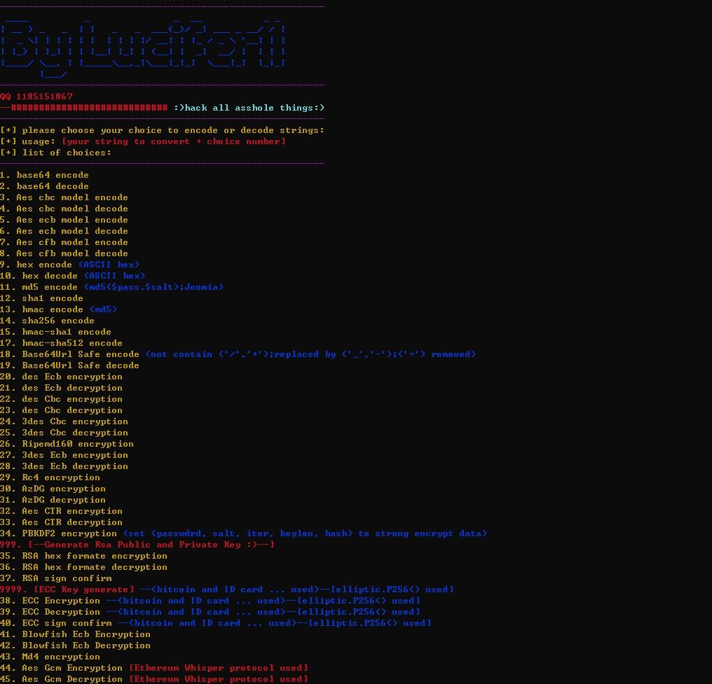
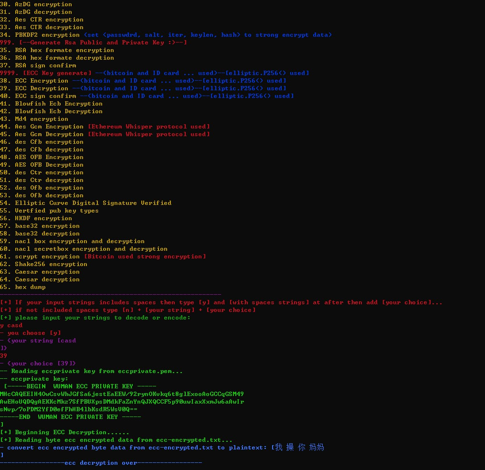

# goendecoder

一个面向 CTF 和本地算法练习的 Go 命令行工具。菜单涵盖常见编码、哈希、密钥派生、对称加密，以及 RSA、ECC 等公钥操作。

> [!WARNING]
> **仅供本地学习，不用于生产。** 项目含过时算法和固定示例密钥，请勿用于保护真实数据、凭据或通信。请勿将实际使用的私钥提交到仓库或发到公开日志。

[快速开始](#快速开始) · [菜单速查](#菜单速查) · [界面预览](#界面预览) · [启动排查](#启动排查)

## 快速开始

程序会询问输入是否包含空格。下面是交互输入，不是系统命令：

| 模式 | 交互格式 |
| --- | --- |
| 不含空格 | 输入 `n <字符串> <菜单编号>` |
| 含空格 | 输入 `y <字符串>`，再按提示在下一行输入菜单编号 |

例如，把 `hello` 编码为 Base64：

```text
n hello 1
```

预期编码结果为 `aGVsbG8=`。用菜单 `2` 可解码回 `hello`。Base64 是编码，不提供保密性。

<details>
<summary>ECC 演示：生成密钥、加密和解密</summary>

1. 输入 `n demo 9999`，生成本地演示密钥。
2. 输入 `n hello 38`，加密结果写入 `ecc-encrypted.txt`。
3. 输入 `n demo 39`，程序从本地文件读取密文并解密。此处的 `demo` 只是交互格式所需的占位输入，不是密文。

每条命令对应一次程序交互。只使用演示数据，勿复制终端打印的私钥。

</details>

## 菜单速查

编号沿用当前命令行菜单，未列出的编号不是文档漏项。表中成对编号依次为编码／解码或加密／解密。

| 类别 | 操作 | 菜单编号 |
| --- | --- | --- |
| 编码 | Base64 · Base64 URL-safe · Base32 | `1` / `2` · `18` / `19` · `57` / `58` |
| 编码 | ASCII Hex · Hex dump | `9` / `10` · `65` |
| 哈希 | MD5（含盐示例） · SHA-1 · SHA-256 · RIPEMD-160 · MD4 · SHAKE256 | `11` · `12` · `14` · `26` · `43` · `62` |
| 消息认证 | HMAC-MD5 · HMAC-SHA1 · HMAC-SHA512 | `13` · `15` · `17` |
| 密钥派生 | PBKDF2 · HKDF · scrypt | `34` · `56` · `61` |
| AES | CBC · ECB · CFB | `3` / `4` · `5` / `6` · `7` / `8` |
| AES | CTR · GCM · OFB | `32` / `33` · `44` / `45` · `48` / `49` |
| DES | ECB · CBC · CFB · CTR · OFB | `20` / `21` · `22` / `23` · `46` / `47` · `50` / `51` · `52` / `53` |
| 其他对称操作 | 3DES-CBC · 3DES-ECB · AzDG · Blowfish-ECB · Caesar | `24` / `25` · `27` / `28` · `30` / `31` · `41` / `42` · `63` / `64` |
| 其他对称操作 | RC4 · NaCl secretbox | `29` · `60` |
| RSA | 生成密钥 · 加密／解密（Hex） · 签名确认 | `999` · `35` / `36` · `37` |
| ECC | 生成 P-256 密钥 · 加密／解密 · 签名确认 · ECDSA 验签 | `9999` · `38` / `39` · `40` · `54` |
| 其他公钥操作 | 检查公钥类型 · NaCl box | `55` · `59` |

## 界面预览



<details>
<summary>查看另一张终端截图</summary>



</details>

## 启动排查

- 源码位于 [`sourcecode/`](sourcecode/)。仓库没有 Go module 清单，不能假定全新环境下直接运行 `go build` 就能成功。
- 程序从**当前工作目录**读取 [`flag.txt`](flag.txt)。遇到找不到文件的错误时，确认启动目录包含该文件。
